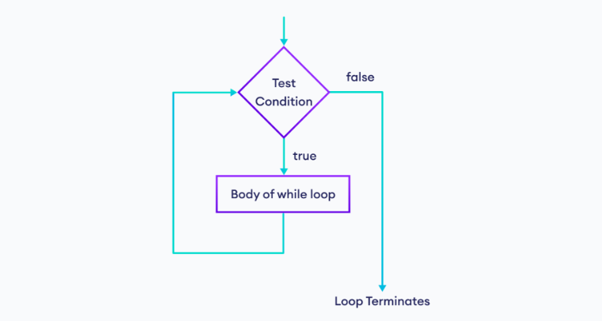

# JavaScript `while` Loop

A comprehensive guide covering the `while` loop in JavaScript, condition handling, infinite loop prevention, the `break` keyword, interactive user prompts, array iterations, and practical applications.

---

## Table of Contents
- [Introduction](#introduction)
- [How It Works](#how-it-works)
- [Flowchart of while Loop](#flowchart-of-while-loop)
- [Syntax](#syntax)
- [Basic Examples](#basic-examples)
  - [Example 1: Printing 1 to 5](#example-1-printing-1-to-5)
  - [Example 2: Input Validation](#example-2-while-loop-with-user-input)
- [Infinite Loops](#infinite-loops)
- [The break Keyword](#the-break-keyword)
- [Interactive Project: Favorite Movie Guessing Game](#interactive-project-favorite-movie-guessing-game)
  - [Approach 1: Condition-Based Exit](#approach-1-condition-based-exit)
  - [Approach 2: Using the break Keyword](#approach-2-using-the-break-keyword)
- [Iterating Over Arrays with while Loop](#iterating-over-arrays-with-while-loop)
- [Practical Project: Todo App (Console/Prompt Based)](#practical-project-todo-app-consoleprompt-based)
- [When to Use a while Loop](#when-to-use-a-while-loop)
- [Conclusion](#conclusion)

---

## Introduction

The `while` loop is a fundamental control structure in JavaScript that allows you to execute a block of code repeatedly based on a specified condition. It is particularly useful when you don't know in advance how many times you need to iterate and the number of iterations depends on a condition that may change during execution.

The while loop repeatedly executes a block of code as long as a specified condition is true.

---

## How It Works

Here,

1. The while loop first evaluates the condition inside `( )`.
2. If the condition evaluates to `true`, the code inside `{ }` is executed.
3. Then, the condition is evaluated again.
4. This process continues as long as the condition evaluates to true.
5. If the condition evaluates to `false`, the loop stops.

---

## Flowchart of while Loop

<br>



---

## Syntax

The basic syntax of a `while` loop is as follows:

```javascript
while (condition) {
    // Code to be executed
}
```

### Components:

- **`condition`**: A boolean expression that is evaluated before each iteration. If the condition is `true`, the code block inside the loop is executed. If the condition is `false`, the loop terminates, and execution continues with the code following the loop.
- **`Code to be executed`**: This is the block of code that will run repeatedly as long as the condition is `true`.

---

## Basic Examples

### Example 1: Printing 1 to 5

```javascript
let count = 1;

while (count <= 5) {
    console.log("Count is: " + count);
    count++;
}
```

**Alternative Counter Example:**

```javascript
let i = 1;

while (i <= 5) {
    console.log(i);
    i++;
}
```

**Explanation:**
- **Initialization**: The variable `count` is initialized to `1`.
- **Condition**: The loop checks if `count` is less than or equal to `5`.
- **Execution**: If `true`, the loop prints the current value and increments `count` by `1`.
- The loop repeats until `count` exceeds `5`.

**Output:**
```text
Count is: 1
Count is: 2
Count is: 3
Count is: 4
Count is: 5
```

### Example 2: `while` Loop with User Input

A `while` loop can be used to repeatedly prompt the user for input until they provide a valid response:

```javascript
let userInput;

while (userInput !== "yes") {
    userInput = prompt("Do you want to continue? Type 'yes' to proceed.");
}

console.log("Thank you for confirming!");
```

**Explanation:**
- The loop continues prompting the user to type `"yes"` until they do so.
- Once the user types `"yes"`, the condition `userInput !== "yes"` evaluates to `false`, and execution exits the loop.

---

## Infinite Loops

One common pitfall with `while` loops is creating an infinite loop, where the loop's condition never becomes `false`, causing execution to hang indefinitely.

### Example of an Infinite Loop:

```javascript
let i = 0;

while (i < 5) {
    console.log("This will run forever!");
    // i is never incremented, so the condition remains true forever
}
```

**How to Avoid Infinite Loops:**
- Ensure that the condition expression will eventually evaluate to `false`.
- Ensure update variables (increments/decrements) execute inside the loop body.

---

## The `break` Keyword

The `break` statement immediately terminates the loop execution regardless of whether the loop condition is still `true`.

```javascript
let i = 1;

while (i <= 5) {
    if (i == 4) {
        break; // Loop terminates when i reaches 4
    }
    console.log(i);
    i++;
}
```

**Output:**
```text
1
2
3
```

---

## Interactive Project: Favorite Movie Guessing Game

### Approach 1: Condition-Based Exit

This implementation tests both the guess accuracy and the quit command directly within the `while` header using the logical `&&` operator:

```javascript
let favrtMovie = "Avatar";
let guessMovie = prompt("Guess My favourite Movies");

while ((guessMovie != favrtMovie) && (guessMovie != "quit")) {
    console.log("Wrong guess!");
    guessMovie = prompt("Guess Again");
}

if (guessMovie == favrtMovie) {
    console.log("Congratulations! you have guessed correct");
} else if (guessMovie == "quit") {
    console.log("You Quited.! You tried your best. better luck next time.");
}
```

### Approach 2: Using the `break` Keyword

This approach keeps the primary condition focused on the movie name and handles exit requests inside via `break`:

```javascript
let favrtMovie = "Avatar"; 
let guess = prompt("Guess My favourite Movies");

while (guess != favrtMovie) {
    if (guess == "quit") {
        console.log("you quited");
        break;
    }
    guess = prompt("you guessed wrong try again.");
}

if (guess == favrtMovie) {
    console.log("congratulations! You Guessed Correct.");
}
```

---

## Iterating Over Arrays with `while` Loop

While `for` and `for...of` loops are frequently used for arrays, a `while` loop can iterate through elements using an explicit index counter:

```javascript
let fruits = ["Apple", "Banana", "Mango", "Orange"];
let index = 0;

while (index < fruits.length) {
    console.log(index, fruits[index]);
    index++;
}
```

---

## Practical Project: Todo App (Console/Prompt Based)

A complete console application demonstrating an infinite loop (`while(true)`) controlled by `break`, user prompts, and array manipulation:

```javascript
let todo = [];
let req = prompt("enter your request");

while (true) {
    if (req == "quit") {
        console.log("you are quitting the app");
        break;
    }
    
    if (req == "list") {
        console.log("----------");
        for (let i = 0; i < todo.length; i++) {
            console.log(i, todo[i]);
        }
        console.log("----------");
    } else if (req == "add") {
        let task = prompt("please enter the task you wanna add");
        todo.push(task);
        console.log("task added");
    } else if (req == "delete") {
        let indx = prompt("enter the index of the task you wanna delete");
        todo.splice(indx, 1);
        console.log("task deleted");
    } else {
        console.log("wrong request, please try again");
    }

    req = prompt("please enter your request");
}
```

---

## When to Use a `while` Loop

- **Unknown Number of Iterations**: Use a `while` loop when the total cycle count cannot be predicted and relies on changing runtime variables.
- **State-Driven Loops**: When code execution must continue continuously until an explicit external state, event, or input changes.

---

## Conclusion

The `while` loop provides granular control over repeated operations where execution conditions are evaluated dynamically. Combined with condition expressions, array indexing, and keywords like `break`, it forms the backbone of custom input validations, game loops, and interactive terminal workflows.